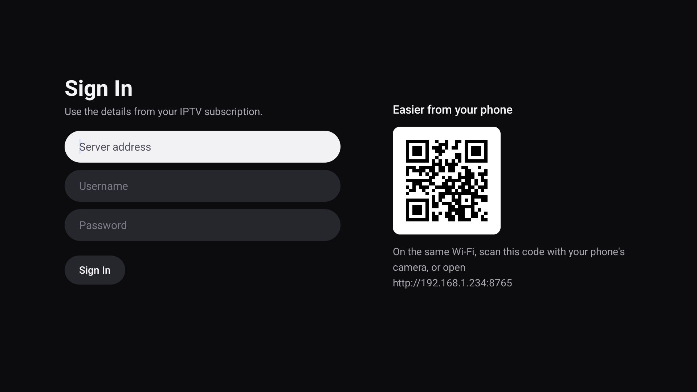

# IPTV

A fast, native IPTV player for **Android TV** and **Android phones**, in a single ~125 KB APK.

Sign in with your own Xtream Codes compatible subscription and browse live channels, movies and
series with a remote or by touch. No ads, no accounts, no tracking.

> **This is a player only.** It comes with no provider, no channels, no playlists and no streams,
> and it is not affiliated with any IPTV service. It is intended solely for content you have the
> legal right to watch. See the [legal disclaimer](DISCLAIMER.md).



## Features

- **Live TV** — categories, channel list with now/next programme guide, favourites, recently watched.
- **Movies and series** — poster grids, detail pages, seasons and episodes, resume where you left off.
- **Home** — live category shortcuts, Continue Watching, latest and recommended titles.
- **Search** across channels, movies and series, with results as you type.
- **Built for a remote** — every action reachable with arrows, OK and Back; hold OK for options.
- **Touch** — tap, drag and long-press on phones and tablets (landscape).
- **Language and region filters** — show only what you watch; hide or pin individual categories.
- **Player** — channel zapping, last-channel recall, audio and subtitle tracks, picture modes,
  accelerated seeking, automatic next episode.
- **Phone pairing** — scan a QR code on the TV to type your sign-in on your phone.
- **Large libraries** — the catalogue is stored in SQLite; 150,000+ titles stay smooth on a 2 GB box.

## Requirements

- Android 8.0 (API 26) or newer, phone or Android TV / Google TV.
- An Xtream Codes compatible subscription: server address, username and password.

The project cannot help you find a subscription or content; requests for sources are closed.

## Build

The project deliberately has no Gradle and no third-party dependencies. It compiles with the JDK and
the Android SDK command-line tools.

Prerequisites: JDK 17, Android SDK with `build-tools` and a `platforms/android-*` package.
Adjust the paths at the top of `build-apk.ps1` if yours differ.

```powershell
powershell -ExecutionPolicy Bypass -File build-apk.ps1
```

The signed APK is written to `dist\iptv.apk`. The first build creates a local signing key in
`build\iptv-release.jks`; keep that file if you want later builds to install as updates.

## Download

Get the latest APK from the [Releases page](https://github.com/Noamcelermajer/iptv-android/releases/latest).
One universal APK covers Android TV, phones and tablets on every CPU type (the app has no native code).

## Install

On a phone or tablet, open the downloaded APK. On Android TV:

```bash
adb connect <device-ip>:5555
adb install -r dist/iptv.apk
```

or run `install-to-tv.bat` on Windows for a guided wireless install.

## Controls

| Where | Remote | Touch | Action |
| --- | --- | --- | --- |
| Lists | OK | Tap | Open or play |
| Lists | Hold OK | Long-press | Favourite, My List, hide or pin a category |
| Anywhere | Back | Back | Up one level; twice on Home to exit |
| Live playback | Up / Down | — | Previous / next channel |
| Live playback | OK | Tap | Channel list |
| Live playback | Left / Right | — | Last channel / options |
| Movie playback | Left / Right | — | Seek (hold to accelerate) |
| Movie playback | OK | Tap | Pause, show controls |

## Project layout

```
android/
  AndroidManifest.xml
  res/                      launcher icon, TV banner, strings
  src/tv/iptv/player/
    MainActivity.java       navigation, Back handling, sync
    RList.java              recycling list/grid that owns focus and eases scroll per frame
    *Screen.java            Home, Live, Browse, Detail, Search, Settings
    PlayerController.java   playback on the platform MediaPlayer, off the UI thread
    Db.java                 SQLite catalogue, favourites, progress
    Xtream.java             Xtream Codes client and library sync
    Img.java, Epg.java      image cache and programme guide
    Qr.java                 QR encoder for phone pairing
build-apk.ps1               aapt2 -> javac -> d8 -> zipalign -> apksigner
```

## Status

Developed and tested on Android TV (Google TV streamer, Android 14). Touch support is new and has
had less testing than remote control.

## Legal

- **No content is included or provided.** The app plays only what the server you enter delivers.
- **Lawful use only.** Use it with sources you are authorised to access. The contributors do not
  condone piracy, and you are responsible for complying with the laws that apply to you.
- **No affiliation.** Names and logos shown in the app come from your own source and belong to
  their owners.
- **No data collection.** Your sign-in stays on your device.
- **No warranty.** Provided "as is" under the MIT License.

Full text: [DISCLAIMER.md](DISCLAIMER.md).

## License

[MIT](LICENSE)
